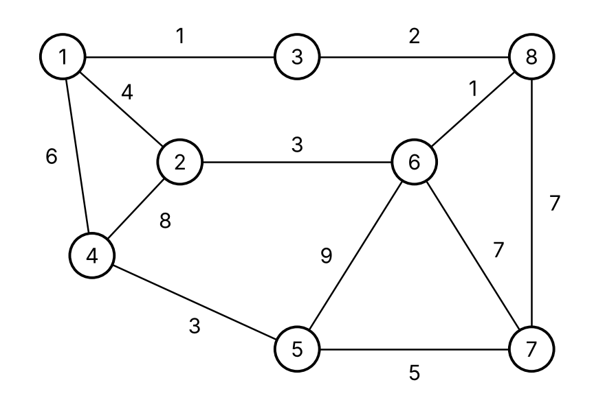
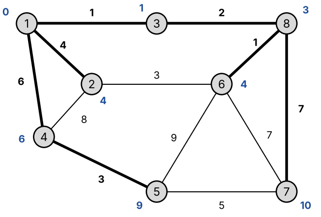

# Лабораторна робота № 6 — Алгоритми на графах. Пошук найкоротшого шляху

## Варіант 22

Вхідні дані: зважений неорієнтований граф, `|V| = 8`, `|E| = 12`, початкова вершина для алгоритму Дейкстри — `s = 1`.



Ребра графа: `(1,3)=1, (3,8)=2, (1,2)=4, (1,4)=6, (2,6)=3, (2,4)=8, (6,8)=1, (5,6)=9, (6,7)=7, (7,8)=7, (4,5)=3, (5,7)=5`

## Результати

**Алгоритм Дейкстри** (від вершини 1):

| Вершина | 1 | 2 | 3 | 4 | 5 | 6 | 7 | 8 |
|---|---|---|---|---|---|---|---|---|
| `dist` | 0 | 4 | 1 | 6 | 9 | 4 | 10 | 3 |
| `pred` | -1 | 1 | 1 | 1 | 4 | 8 | 8 | 3 |

Найкоротші шляхи: `1→2 (4)`, `1→3 (1)`, `1→4 (6)`, `1→4→5 (9)`, `1→3→8→6 (4)`, `1→3→8→7 (10)`, `1→3→8 (3)`.



**Алгоритм Флойда** — матриця найкоротших відстаней `D(8)`:

| | 1 | 2 | 3 | 4 | 5 | 6 | 7 | 8 |
|---|---|---|---|---|---|---|---|---|
| **1** | 0 | 4 | 1 | 6 | 9 | 4 | 10 | 3 |
| **2** | 4 | 0 | 5 | 8 | 11 | 3 | 10 | 4 |
| **3** | 1 | 5 | 0 | 7 | 10 | 3 | 9 | 2 |
| **4** | 6 | 8 | 7 | 0 | 3 | 10 | 8 | 9 |
| **5** | 9 | 11 | 10 | 3 | 0 | 9 | 5 | 10 |
| **6** | 4 | 3 | 3 | 10 | 9 | 0 | 7 | 1 |
| **7** | 10 | 10 | 9 | 8 | 5 | 7 | 0 | 7 |
| **8** | 3 | 4 | 2 | 9 | 10 | 1 | 7 | 0 |

За 8 ітерацій виконано 24 оновлення відстаней (без урахування симетричних). Перший рядок `D(8)` повністю збігається з результатом алгоритму Дейкстри (таблиця 6.5).

У реалізації Дейкстри з `priority_queue` оброблено 8 вершин: 9 вилучень із черги (один застарілий запис для вершини 5), 24 перегляди ребер, 8 успішних релаксацій.

## Структура репозиторію

| Файл | Опис | Відповідає у звіті |
|---|---|---|
| `dijkstra.cpp` | Алгоритм Дейкстри (списки суміжності + черга з пріоритетом `priority_queue`, старт з вершини 1) | Лістинг 6.2, лістинг 6.3 |
| `floyd.cpp` | Алгоритм Флойда (вагова матриця, виведення всіх матриць D(0)–D(8)) | Лістинг 6.5, лістинг 6.6, таблиці 6.3–6.4 |
| `images/graph.png` | Граф варіанта 22 | Рисунок 6.1 |
| `images/dijkstra_step0.png` … `dijkstra_step8.png` | Покроковий хід алгоритму Дейкстри | Таблиця 6.1 |
| `images/shortest_path_tree.png` | Дерево найкоротших шляхів від вершини 1 | Рисунок 6.2 |
| `ЛР6_22_АІ254_Церковний_Олександр.docx` | Звіт з лабораторної роботи | — |
| `ЛР6_22_АІ254_Церковний_Олександр.pdf` | Звіт у форматі PDF | — |

## Запуск

```bash
g++ -std=c++17 -Wall -Wextra -o dijkstra dijkstra.cpp
./dijkstra

g++ -std=c++17 -Wall -Wextra -o floyd floyd.cpp
./floyd
```

Програми не потребують вхідних даних — граф варіанта 22 задано в коді. 

Також код можна запустити в онлайн-компіляторі, наприклад [OnlineGDB](https://www.onlinegdb.com/online_c++_compiler).
